<!-- ═══════════════════════════  HEADER  ═══════════════════════════ -->
<p align="center">
  
</p>

<p align="center">
  <a href="https://github.com/rugvedk31">
    
  </a>
</p>

<p align="center">
  
  <a href="https://github.com/rugvedk31"></a>
  <a href="https://www.linkedin.com/in/rugvedkumbhar31"></a>
  <a href="https://leetcode.com/RugvedVK"></a>
  
</p>

<br/>

<!-- ═══════════════════════════  TERMINAL  ═══════════════════════════ -->
<p align="center">
  
</p>


## 🧬 `class RugvedKumbhar(Agent):`


```python
from dataclasses import dataclass

@dataclass(frozen=True)
class Rugved:
    role: str     = "AI/ML Intern @ Emerson"
    college: str  = ("DKTE Society's Textile"
                     " & Engineering Institute")
    year: str     = "Final-year CS 🎓"
    city: str     = "Pune, India 📍"
    builds: tuple = ("Agentic AI", "LangGraph")
    learns: tuple = ("Advanced RAG", "LLMOps",
                     "AWS", "Azure")
    leetcode: str = "400+ solved 💻"
    patent: str   = "RoomBuddy 🏠"

    def motto(self) -> str:
        return "Ship AI to production 🚀"
```

<br clear="right"/>

<p align="center">
  
</p>


## ⚡ Arsenal

<p align="center">
  
</p>

<table align="center">
  <tr>
    <td align="center" width="140"><b>🤖 AI / ML</b></td>
    <td>
      
      
      
    </td>
  </tr>
  <tr>
    <td align="center"><b>⚙️ Backend & Frontend</b></td>
    <td></td>
  </tr>
  <tr>
    <td align="center"><b>☁️ Cloud & DevOps</b></td>
    <td></td>
  </tr>
  <tr>
    <td align="center"><b>🧰 Dev Tools</b></td>
    <td>
      
      
    </td>
  </tr>
</table>


## 💭 Thought of the Day

<p align="center">
  
</p>


## 📊 Telemetry

<table align="center">
  <tr>
    <td></td>
    <td></td>
  </tr>
  <tr>
    <td></td>
    <td></td>
  </tr>
</table>

<p align="center">
  <a href="https://github.com/rugvedk31">
    
  </a>
</p>

### 🐍 Watch the snake eat my contributions

<p align="center">
  <picture>
    <source media="(prefers-color-scheme: dark)" srcset="https://raw.githubusercontent.com/rugvedk31/rugvedk31/output/github-snake-dark.svg"/>
    <source media="(prefers-color-scheme: light)" srcset="https://raw.githubusercontent.com/rugvedk31/rugvedk31/output/github-snake.svg"/>
    
  </picture>
</p>


## 🤝 Let's Build Something That Ships

<p align="center">
  <a href="https://www.linkedin.com/in/rugvedkumbhar31"></a>
  <a href="https://leetcode.com/RugvedVK"></a>
  <a href="https://github.com/rugvedk31"></a>
</p>

<p align="center">
  
</p>

<p align="center"><sub>Crafted with ☕ + 🧠 by <a href="https://github.com/rugvedk31">Rugved Kumbhar</a> · Last updated: October 2026</sub></p>


